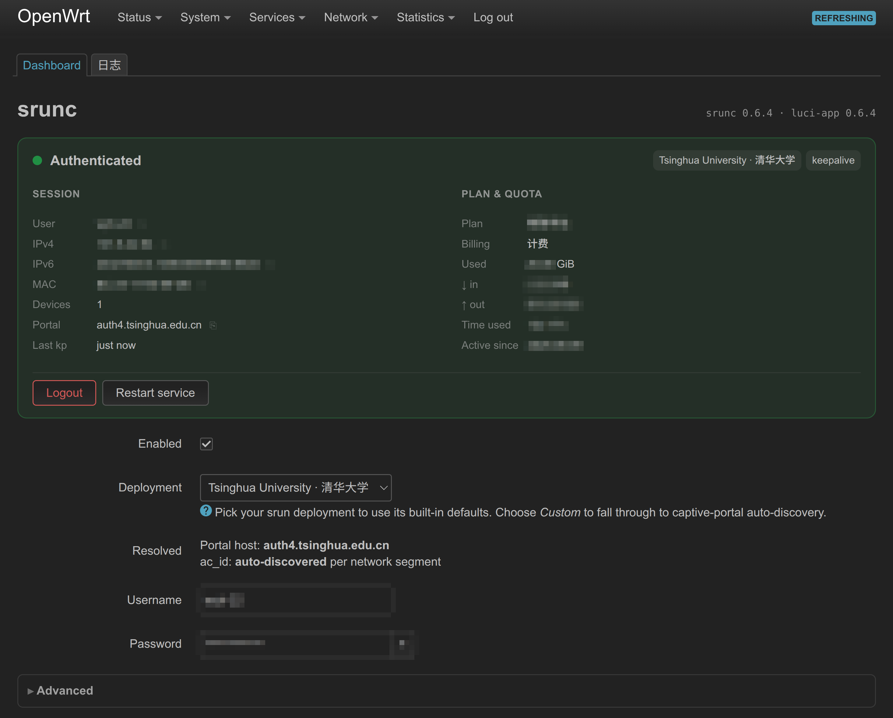

# srunc

Tiny static-binary client for **srun** (深澜) captive portals.

## Install

Pick your platform:

- [**OpenWrt**](docs/install/openwrt.md) — `opkg install` the `.ipk`, configure via LuCI
- [**Debian / Ubuntu**](docs/install/debian.md) — `apt install ./srunc_*.deb`, runs under systemd
- [**Prebuilt binary**](docs/install/binary.md) (macOS / Windows / other Linux) — `cargo binstall srunc` or a tarball from the release page
- [**From source**](docs/install/source.md) — `cargo install srunc`

## Usage

```sh
srunc login          # prompts for username + password
srunc login -k       # keep the session alive (re-auth on drop)
srunc status
srunc logout
```

Host and `ac_id` are auto-discovered from the captive redirect — most networks
need nothing more than username + password. To skip the prompt, drop a config
at `~/.config/srunc/config.toml` (see [`docs/config.example.toml`](docs/config.example.toml)).

On platforms without `/proc/net/route` (macOS, Windows), srunc can't read the
default route itself. Pass the address to probe explicitly (usually the
gateway) and discovery will query it:

```sh
srunc --probe-ip 192.168.1.1 login
```

The same value can be set as `probe_ip = "192.168.1.1"` in the config. Explicit
`--host` / `--ac-id` (or a `--profile`) still take priority, so `--probe-ip` is
only needed when discovery is in play.

## Figures

### OpenWRT


